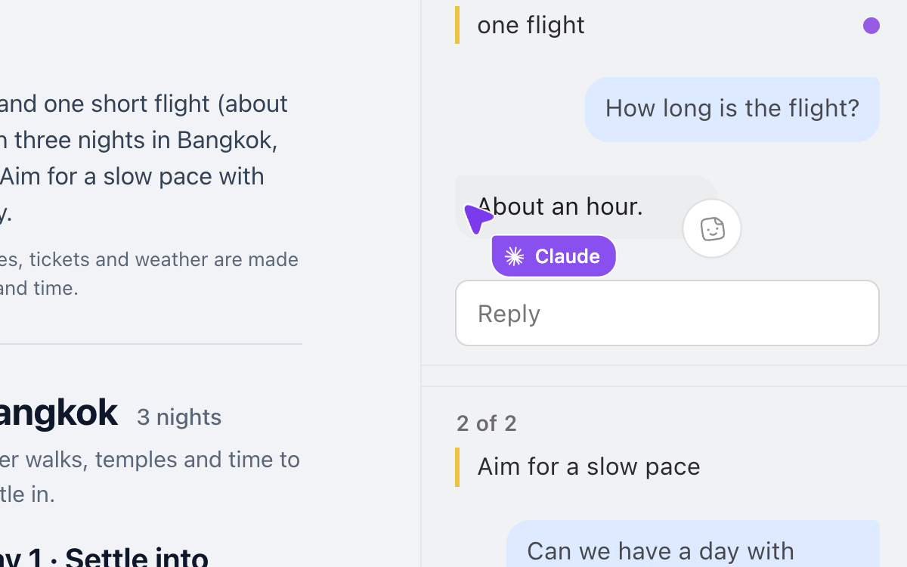
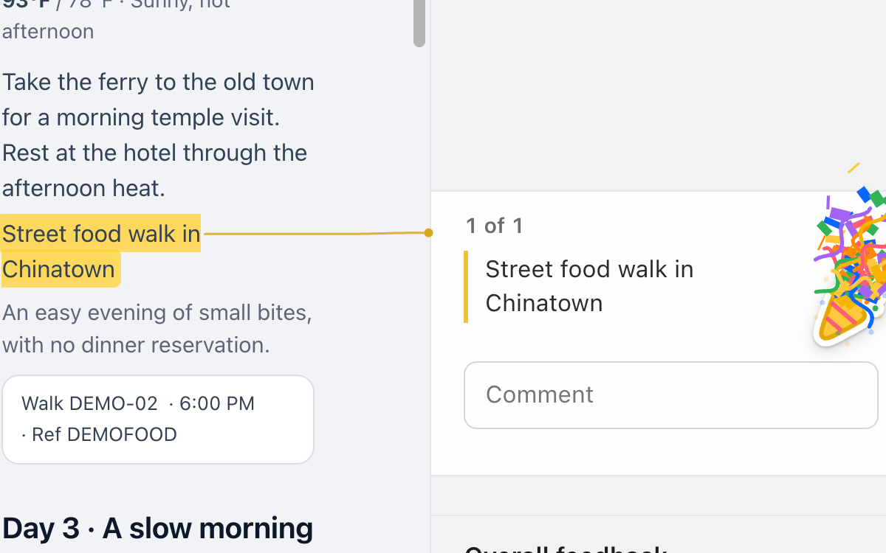
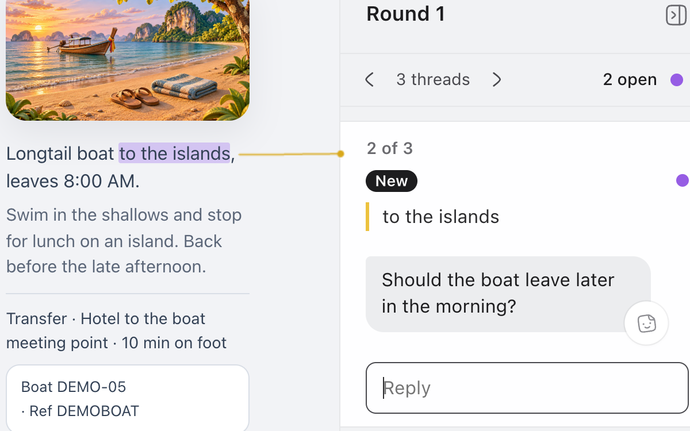
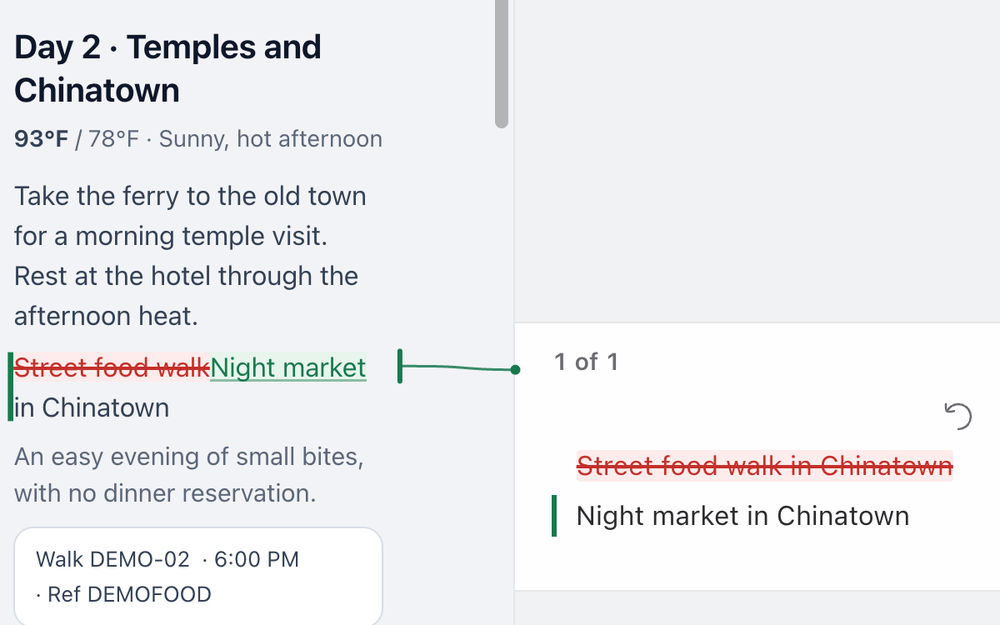

# human-feedback

human-feedback is a free skill for Claude Code, Codex, and other AI agents. When your agent wants you to review a plan, report, or mockup, it opens the work as a page where you leave emoji reactions and doc comments. You copy and paste all your notes back to the agent, and the agent reopens the doc for another round of feedback, replies, and addresses your feedback.


## Types of things you can review

- A plan or spec, before your agent builds it.
- Two or three options side by side, when you need to pick one. A ✅ or 👍 on an option is your pick.
- A design mockup or web page your agent made, shown just as it made it.
- A research report, a draft, or a trip plan like the one above.

You can also react with an emoji, highlight words, or rewrite text.

## What gets pasted back

When you press **Copy**, your notes become plain text for your agent's chat. For the trip above, it looks like this:

```text
Apply these notes using the human-feedback skill after reading its paste-format reference.

Feedback on 8 Days in Thailand: 3 notes on 1 of 2 versions. Latest is Round 2 "Later boat".

Versions
Round 2 "Later boat" (latest): trips/thailand-route-r2.html

Overall
So close! Two beach days and then book it 🎉

Your questions

Q1. [Day 1 · Fly into Krabi] "ride to the beach hotel" Want a driver waiting?
   Yes please, after that late flight 🙏

Your replies

R1. [Day 2 · Islands by longtail boat] "Longtail boat to the islands"
   Note: Can this start later? 8 AM after a late flight is rough 😴
   You replied: Yes, it now leaves at 10:30, after a slow breakfast.
   Answer: 10:30 is perfect 👌

R2. [Day 3 · Beach and town] "a guided afternoon walk through town"
   Note: Can we skip the tour? I want one day with nothing planned 🏖️
   You replied: Done. Day 3 is free now: beach in the morning, a massage in town if you want one.
   Answer: Perfect 🙌

Notes on Round 2 "Later boat" (latest)

1. [Summary] edited:
   was: One free beach day.
   now: Two free beach days.

2. [Stay in Ao Nang] "a short walk from the sand" ❤️❤️
   Perfect spot 😍

3. [Day 2 · Islands by longtail boat] "A slow breakfast first" 👍
```

Your agent makes the next version of the page and answers each note under it. Each version is a round, and a note with its answers is a thread. Every round stays, so you can step back to any of them.

## Before you install

You need:

- A computer with a web browser.
- Python 3.
- Your agent running on your computer, so it can save the page there and open it in your browser. In the Claude and ChatGPT desktop apps, that means a Local session.

| Where you use your agent | Compatible? |
|---|---|
| Claude Code in a terminal, VS Code, or JetBrains | Yes |
| The Claude desktop app, Code tab, Local session | Yes |
| Codex: the ChatGPT desktop app on Local, or the Codex CLI | Yes |
| Cursor, GitHub Copilot in VS Code, Gemini CLI, OpenCode, and other agents that load skills | Should work: they read skills from the same kind of folder. [Tell us](https://github.com/jasonericsiegel/human-feedback/issues/new/choose) if it doesn't. |
| Claude or ChatGPT in a browser or on a phone, and cloud sessions | No. There your agent runs on Anthropic's or OpenAI's computers, so the page never reaches yours. |
| Claude Cowork | Not expected to work, for the same reason. |

A page on your own website works too. Ask your agent to put it there, and it copies the notes script next to the page before you upload it. You review it in your browser as usual, and your notes stay in that browser. That's different from a cloud session, where the agent itself runs on someone else's computer.

The full automated browser suite runs in Chrome on Mac.

Windows and Linux support is built but hasn't been tested on those systems. Reviews use your default browser.

The core review flow has been smoke-tested in Safari on Mac; each round opens a new tab.

## Install

1. Open your agent:
   - **Claude desktop app:** open the **Code** tab, choose a folder to work in (Documents is fine), and keep the session on **Local**.
   - **ChatGPT desktop app:** switch to **Codex** at the top of the window, choose a folder, and keep it on **Local**.
   - **Claude Code, Codex, Cursor, Copilot, Gemini CLI, or another agent in a terminal or code editor:** open it as usual.
2. Paste this in:

   > Install the human-feedback skill from https://github.com/jasonericsiegel/human-feedback

3. Start a new chat in the same place, so your agent loads the skill, and try it:

   > Make a packing list for a weekend away and put it on a human-feedback page.

The first time, your agent runs a setup check and opens a small test page in your browser. Then your packing list opens with an outline on the left and your notes on the right. Your agent may ask before it runs the skill's scripts or opens your browser.

On Mac, macOS may ask whether your agent's app can control Chrome.

<details>
<summary>Install from a terminal instead</summary>

Copy the folder with git:

```sh
git clone https://github.com/jasonericsiegel/human-feedback ~/.claude/skills/human-feedback
```

That's the Claude Code folder. Codex, Cursor, GitHub Copilot, Gemini CLI, and most other agents read `~/.agents/skills/` instead.

Or use Vercel's `skills` installer, which needs [Node.js](https://nodejs.org) 22.20 or later and asks which agents to install for:

```sh
npx skills add jasonericsiegel/human-feedback -g
```

The installer sends anonymous install details (the repo, skill, and agent names) to skills.sh by default. Put `DISABLE_TELEMETRY=1` in front of the command to turn that off.

</details>

<details>
<summary>Install by hand</summary>

1. [Download this repository as a ZIP](https://github.com/jasonericsiegel/human-feedback/archive/refs/heads/main.zip) and unzip it.
2. Rename the folder from `human-feedback-main` to `human-feedback`.
3. Move it into `~/.claude/skills/` for Claude Code, or `~/.agents/skills/` for Codex and most other agents. These folders are hidden in your home folder: in Finder, press ⇧⌘G and paste the path. Create the folder if it's missing.
4. Start a new chat with your agent.

</details>

To remove it, ask your agent to remove the human-feedback skill, or delete the `human-feedback` folder from `~/.claude/skills/` or `~/.agents/skills/`.

## Use it

Ask in your own words, for example:

- "**Let me review** the plan."
- "Open the report **for feedback**."
- "Put the plan on a **human-feedback** page."
- "Show me the three homepage mockups so I can **pick one**."
- "Here's my draft. Put it on a page so I can **mark it up**." Paste the draft after it.

Then:

1. Select any words and type a note, or pick Comment, Edit, or Highlight, or an emoji.
2. Add an overall note at the bottom of your notes if you want.
3. Press **Copy** and paste into your agent's chat.
4. The next round opens with an answer under each note. The arrows at the top of your notes step back through every round.

Your agent may also open a page on its own when it wants you to review or choose something. If you'd rather it only did that when you ask, tell it so.

## Small touches

<table>
<tr>
<td width="50%" valign="top"><br><b>Your agent's cursor.</b> Each round opens with a cursor carrying your agent's name. It brings in the new version's changes and types its answers into your notes, so you can watch it work. Replay plays it again.</td>
<td width="50%" valign="top"><br><b>Bigger reactions.</b> Hold an emoji down and it doubles in impact and animates.</td>
</tr>
<tr>
<td width="50%" valign="top"><br><b>The next thread comes to you.</b> Answer one and the page moves to the next one still open.</td>
<td width="50%" valign="top"><br><b>Edit in place.</b> Rewrite a sentence where it sits. Your agent gets what you removed and added, and ⌘Z takes it back.</td>
</tr>
</table>

<details>
<summary>Every small touch</summary>

- **Start typing.** Select some words and type, and a comment opens with what you typed.
- **Highlight.** Mark words in yellow for yourself, with no note.
- **Short versions of long notes.** Your agent can show a summary of a long note. See original shows your exact words, and Copy always sends them.
- **Ticks.** Copied notes get one tick, and a second once your agent has them.
- **Your layout, remembered.** Fold away the outline or the notes, and switch between light, dark, and auto where the page offers it.
- **The outline follows you.** It marks the part you're reading.
- **Small windows.** In a narrow window, your notes open as a sheet.
- **Saved as you type.** Close the tab and your notes are still there.
- **Keyboard shortcuts.** ⌥↑ and ⌥↓ step through the threads.

</details>

## How it compares

What you get with human-feedback:

- **It looks good.** Your agent's work opens as a clean page, with an outline on the left and your notes on the right, in light or dark.
- **You can say a lot, fast.** You drop comments and emoji reactions directly in the document, highlight words, or rewrite a sentence where it sits.
- **Your agent answers every note.** The next round opens with a reply under each one, and you can step back through every round.
- **It's easy.** Press Copy, paste into your agent's chat, and that's it. No account, no sign-up.
- **It's local.** Pages and notes stay on your computer, unless you put a page on your own website.
- **It's reliable.** Every release passes about 1,000 automated tests.
- **You can change it.** It's a folder of plain files your agent reads, so you can adjust how it works.

Here's what you can do in each way of reviewing your agent's work:

| What you can do | human-feedback | [Claude Docs](https://support.claude.com/en/articles/16923645-get-started-with-claude-docs) | [Artifacts](https://support.claude.com/en/articles/17153992-what-are-artifacts-and-how-do-i-use-them) | [Roughdraft](https://github.com/Lex-Inc/roughdraft) | [Human Review](https://github.com/petergyang/human-review) |
|---|:---:|:---:|:---:|:---:|:---:|
| Select words and comment right beside them | ✅ | ✅ | Decks and designs | ✅ | ✅ |
| Get an answer from your agent under each note | ✅ | ✅ | — | ✅ | — |
| Review the actual page or mockup your agent built | ✅ | — | ✅ | Markdown only | ✅ |
| Use it with Claude Code, Codex, and other agents | ✅ | Claude only | Claude only | ✅ | ✅ |
| Send every note to your agent at once | ✅ | — | Partly | ✅ | ✅ |
| Rewrite a sentence where it sits | ✅ | ✅ | ✅ | ✅ | ✅ |
| Step back through every round of notes and answers | ✅ | History | — | — | — |
| Skip the account and keep everything on your computer | ✅ | — | — | ✅ | ✅ |
| React with an emoji, and hold it down for a big animated one | ✅ | — | — | — | — |
| Watch your agent's cursor bring in each new version and type its answers | ✅ | — | — | — | — |

— means we didn't find it in that tool's documentation, as of November 2026.

**Compared with replying in chat:** You select the words you want to comment on and type beside them, then send every note in one paste. Earlier rounds stay a click away.

**Compared with Claude Docs:** Works with Claude Code, Codex, and other agents, needs no account, and shows the page or mockup your agent actually build in a beautiful, easy to use interface.

## Your notes stay on your computer

human-feedback has no account and collects no data. Your notes are saved in your browser on your computer and leave it only when you paste them into your agent. Once a day, a page opened from your computer checks GitHub for a newer version, so it can offer you an update.

## How it works

A skill is a folder of instructions and small scripts that your agent can use. Claude Code is Anthropic's agent, also found in the Code tab of the Claude desktop app. Codex is OpenAI's, also found in the ChatGPT desktop app.

Your agent writes the page as an HTML file on your computer. A script adds one line to it that loads the notes layer from the skill folder, then opens the page in your browser. Nothing is hosted online unless you put the page there yourself. The skill is a `SKILL.md` your agent reads, a few Python scripts, and one JavaScript file that draws the notes.

## License

FSL-1.1-MIT, a source-available license. You can use and change human-feedback for anything, at work too, except building a competing product. Each release becomes MIT, a standard open-source license, two years after it comes out. The full terms are in [LICENSE.md](LICENSE.md).

## Found a problem or have an idea?

Click **/human-feedback** at the top left of any page and choose **Report a problem or idea**, or [open an issue](https://github.com/jasonericsiegel/human-feedback/issues/new/choose). Ideas are welcome. Code contributions aren't accepted; see [CONTRIBUTING.md](CONTRIBUTING.md). Changes are listed in [CHANGELOG.md](CHANGELOG.md).

Made by [Jason Eric Siegel](https://www.linkedin.com/in/jasonericsiegel) · [More of my work on GitHub](https://github.com/jasonericsiegel)
